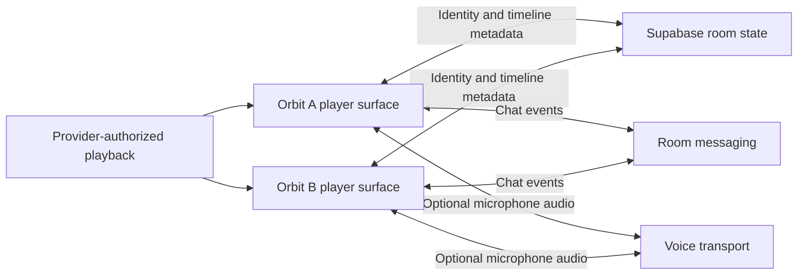

# Watch-party workflows and a better path for Orbit

Research date: November 2, 2026 (UTC). Public-source review completed. No competitor accounts, subscriptions, provider credentials, private APIs or signed-in streams were accessed. Store screenshots were visually inspected in the browser; these are promotional UI evidence, not an end-to-end playback test.

## Main finding

The useful model is **a provider playback surface plus a separate room/synchronization layer**. Teleparty documents starting from the provider's playing website on desktop; its mobile flow authenticates to the provider through the party app. Watchly describes itself as a coordination layer whose participants obtain content through their own provider access. These support separately authorized playback on each device, rather than one phone re-broadcasting its screen.

The public evidence does **not** identify every app's Android rendering engine, DRM/authentication integration, private SDK access or precise drift-correction algorithm. Do not claim they all use WebView, embed Netflix's Android activity, or expose an integration Orbit can copy. Equally, absence of a public Netflix SDK does not prove that no in-app approach can work. The next step is a bounded, legitimate playback feasibility experiment on the real Pixel.

## Evidence labels

- **Documented:** developer support, store description, policy or release notes; not an independent performance audit.
- **Visually observed:** public store screenshots or website demonstrations, not signed-in sessions.
- **Inference/proposal:** our engineering conclusion or proposed Orbit design, not a discovered competitor implementation.
- **Unknown:** not established by the reviewed sources.

## Product comparison

| Product | Documented workflow | UI seen in official public screenshots | Unknown |
|---|---|---|---|
| Rave | Select a provider, sign into that subscription service inside Rave, choose content, invite by room link/friend search. | Android Netflix promotion: member avatars/tools above video, conversation below, microphone and message controls at the bottom. | Android player/browser engine, transport protocol, private integration terms and current phone behavior. |
| Teleparty | Desktop: play a title on the provider website, activate the extension, share its party link. Mobile: sign into the provider through Teleparty, use the party tab and invite/join link. | Desktop video with chat sidebar; phone video above a conversation/composer, with a compact participant toolbar. | Whether mobile shares the desktop implementation, exact provider bridges, buffering barriers and clock policy. |
| Hearo | Developer description: start a party, invite through a link, watch supported services with voice/text. | App Store: Start Party/Join, friends and continue-watching rows, provider grid; promotional phone video above chat and landscape video with avatars. | Current Android behavior, backend/control protocol and Netflix renderer. An accessible listing does not prove playback works. |
| Watchly | Create a party, choose a service/video, invite by code/link, play. Each participant needs provider access. | Android: service grid and code entry; room video above voice participants, messages/GIFs, reactions and composer. | Exact Android rendering/auth path and sync protocol. Cross-linked publishers and inconsistent feature/tier copy need platform-specific validation. |

Sources: [Rave FAQ](https://rave.io/faq), [Rave Android screenshots](https://play.google.com/store/apps/details?id=com.wemesh.android), [Teleparty support](https://dev.teleparty.com/support), [Teleparty Android screenshots](https://play.google.com/store/apps/details?id=com.teleparty.android), [Hearo App Store](https://apps.apple.com/us/app/hearo-watch-together/id1385627895), [Watchly Android screenshots](https://play.google.com/store/apps/details?id=com.meshapp.watchly).

## Identity and freshness checks

**Rave:** Rave Inc., Android package com.wemesh.android. Its FAQ supports provider authentication inside Rave. Its [privacy policy](https://rave.io/privacy) says provider passwords are not retained, but describes viewing, device and network data collection. Orbit should borrow useful interaction patterns without copying the wider data collection.

**Teleparty:** the reviewed Android app is com.teleparty.android, published by Teleparty/WP Interactive Media, Inc. Its [support page](https://dev.teleparty.com/support) has differing service/platform lists; desktop features cannot be assumed present on Android. The [policy](https://dev.teleparty.com/privacy) describes an extension identifier and analytics, and says watch-party chat history is not currently stored. It does not reveal the full synchronization implementation.

**Hearo:** App Store id1385627895 links to hearo.live and identifies Quarter Timer LLC; the [site policy](https://hearo.live/legal/privacy-policy) uses Quarter Time, LLC. This official chain was used instead of assuming the similarly named hearo-app.com belongs to the same product. Old shutdown anecdotes were not treated as current facts. The listing was accessible; installation/active service were not tested. Its policy lists Google services/advertising/analytics/crash reporting, not a Netflix player SDK.

**Watchly:** watchlyparty.com links Android com.meshapp.watchly (APPMESH), Apple id6774012972 (Muhammad Ashir), and a Chrome extension with the Apple developer's identity. Stores also link letswatchly.online. These are cross-linked surfaces; identical code or corporate ownership is not established. The separate com.watchly.app and app.watchly.ai were not substituted. Landing pages, stores and tiers differ in their claims; availability remains a device-test question.

## Useful technical disclosure

[Watchly's developer policy](https://letswatchly.online/#privacy) names Firebase Authentication/Firestore/Storage, Ably for real-time messaging, and Agora for voice. Its terms say it does not host providers' content. This is a concrete disclosed separation of app data, real-time coordination, voice and third-party video, not an explanation of Netflix playback. Its [Chrome listing](https://chromewebstore.google.com/detail/watchly-%E2%80%94-watch-together/lmifcpiknpnmadfoipjdiileejpjoffe) describes a supported-site sidebar, codes/links, Google sign-in and reactions; this does not establish the Android engine.

**Inference for Orbit:** retain Supabase instead of changing vendors to imitate a competitor. Existing room authorization, server anchors and revision/conflict handling are useful. Attach them to a verified in-app provider player. Voice should be a separate mic-only path, not captured Netflix audio or a screen relay.

## Proposed Orbit workflow

1. **Enter a private room.** Keep Orbit Google sign-in and approved-user rules. Create/join through private invitations; public discovery and GPS are unnecessary.
2. **Choose a provider.** Show supported, unverified or unavailable capabilities per device. Keep external Netflix diagnostics outside the ordinary watching flow.
3. **Authenticate with the provider.** A candidate in-app surface must preserve the official origin and provider protections. Orbit must not read passwords/cookies or place app bridges/analytics on authentication pages. Browser-owned session persistence needs an explicit design; sessions must not be exported to the room backend.
4. **Select actual content.** Obtain a stable title/episode identity from the authorized player context. A pasted title, matching duration or successful login does not establish matching episodes.
5. **Show readiness.** Members can be signing in, loading, ready or reconnecting. Display who is waiting before starting the timeline.
6. **Watch in one room.** Portrait: video above conversation; compact member/voice row; visible invite, mute and leave actions. Landscape: video-first with dismissible chat. Keep text available without microphone permission and separate voice/video volume controls.
7. **Recover and end cleanly.** Rejoin at current room state, detect episode changes, handle revoked access and end the party explicitly. Decide message retention and provider-browser cleanup before implementing them.

These are Orbit recommendations inspired by public workflows, not copied screens or shipped features.

## Proposed coordination model, not a proprietary algorithm claim

Each client obtains its own authorized provider stream. Orbit's shared channel carries a room content key, playing/paused state, position, server anchor, revision and readiness. Monotonic timing and bounded clock estimates drive corrections; stale revisions and failed authorization stop control. Origin/revision handling prevents a remote pause from being re-published forever. Late join, buffering, ads, seek-induced resume, episode changes and dropped connections need explicit policies.

The existing real-phone seek changed paused to playing and returned no accepted catalog ID. Those are player-adapter contract issues, not evidence of a ready two-phone movie session.

Provider video, passwords, cookies and DRM material do not go through the proposed room channel. The in-app Netflix surface is the unverified part of this diagram.

## Next experiment and acceptance gates

**First: one-device in-app Netflix playback.** Investigate a legitimate provider/browser or player integration on the physical Pixel with ordinary provider authentication and unmodified protections. No device/certification spoofing, protected-stream extraction or custom Netflix credential form. A normal browser experiment may fail; marketing screenshots and missing public SDKs cannot replace it.

Record whether actual movie frames/audio play inside the app with dependable identity and usable play/pause/seek. Verify fullscreen/orientation, subtitles/audio selection, authentication expiry and safe exit/cleanup. Only then connect the timeline to two actual authorized players on separate devices/networks.

**Second: two-device correctness.** Verify readiness, host control, late join, drift, buffering, reconnection, episode transitions and paused-state preservation. Current external MediaSession testing cannot substitute for this.

**Third: the social room.** Once the player path is established, add text then opt-in voice without broad notification/overlay/file access. Microphone access belongs to joining voice, not opening Orbit or watching. Keep the Netflix-first priority; do not present sample video or another provider as completed Netflix support.

## Limits and resume checkpoint

This review establishes workflows, public UI patterns and some disclosed infrastructure, not the proprietary Android Netflix implementation of any competitor. No player dependency, app build, account, subscription, microphone grant or provider sign-in was created during this research. Orbit remains at 1.2.2 with its external diagnostic and in-app feasibility gap.

The first checkpoint was ef442a6. Resume from this report, NETFLIX_EMBEDDED_FEASIBILITY.md and ANDROID_PERMISSIONS.md. Hibernation pauses local tool work; no offline work, scheduled monitor or automatic resume was configured. Continue this chat after the PC wakes.

## November 3 follow-up: working Rave comparison

The user reports a Netflix movie plays inside the official Rave Android app on their physical Pixel. This is user-reported playback, not our inspection of the player engine or two-device sync. Orbit’s own 1.3.1 layout, keyboard and Google sign-in work, but its browser comparison still does not play the movie. The original 1.2.2 resume checkpoint above is historical. Netflix remains first; see [NETFLIX_NATIVE_INTEGRATION.md](NETFLIX_NATIVE_INTEGRATION.md) for the subsequent native-player/SDK investigation.

## November 3: expanded integration outreach

User-authorized inquiries were sent separately to Rave, Hearo, Teleparty and Watchly using official contact provenance. See [NETFLIX_INTEGRATION_OUTREACH.md](NETFLIX_INTEGRATION_OUTREACH.md) for the historical Hearo business lead, current mobile/desktop distinctions, Watchly infrastructure disclosures and literal TeleTV identity check. No current SDK or working Orbit playback is established.
